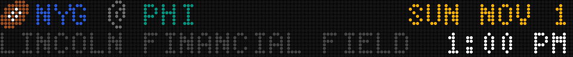
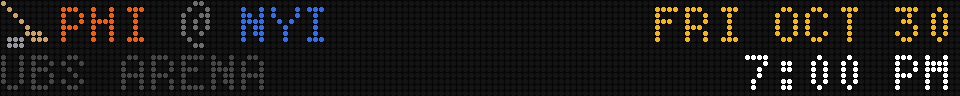
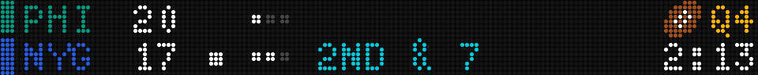
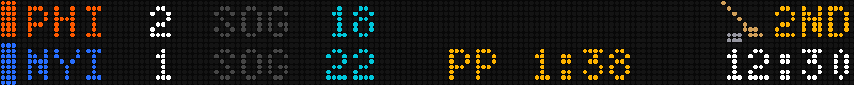
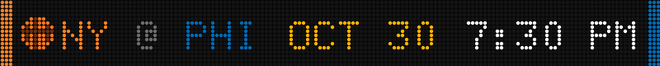
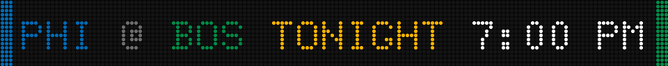

# Smallsign sport icons — design

**Date:** 2026-10-29
**Plugins touched:** `football`, `hockey`, `basketball` (all in this monorepo)
**Sign:** smallsign only (160×16, scale 1)

## Why

On the smallsign, a mixed "Philly sports" rotation is hard to read: the football and hockey cards are built from the same two-band template (same font, same positions, same palette roles), so an upcoming card like `NYG @ PHI · SUN NOV 1 · LINCOLN FINANCIAL FIE… · 1:00 PM` and `PHI @ NYI · FRI OCT 30 · UBS ARENA · 7:00 PM` are indistinguishable at a glance. The only tells are the opponent code and a dim, usually truncated venue. Basketball reads fine today because its single 16-row band looks different.

A per-sport section title (config-only) was considered and rejected: the user loses track mid-rotation, so **the sport cue has to live on every card**, not on a title shown once at section entry.

## Goals

- Every football and hockey smallsign card (upcoming, live, intermission/half, final) carries an 8×8 sport icon.
- Basketball upcoming cards carry the existing `:basketball.ball:` 8×8 when it fits.
- The football and hockey icons are also registered as plugin emoji so configs can use them inline (e.g. section titles), like `:baseball.ball:` / `:basketball.ball:` today.

## Non-goals

- Bigsign / longboi (scale > 1) layouts — unchanged. They already carry a `NEXT GAME` label and logos/chips.
- Baseball — out of scope for this change *(my call; the user didn't weigh in. Its smallsign card may have the same problem and can follow the same pattern later.)*
- Basketball live/final cards — unchanged *(my call; not requested, and the single-band layout is already distinct).*
- Scoring celebrations (`TOUCHDOWN` / `GOAL` / `76ERS WIN` takeovers) — unchanged.
- The `layout = "ticker"` scrolling line — unchanged.
- No new config knob to turn the icon off *(my call — YAGNI; the board palette is already fixed / non-tunable).*

## Anti-goals

- The icon must never collide with or overlap text, pips, or the status column. When there isn't room, the icon is what gives way — never the score, clock, or status.
- No change to the layout of the existing elements on live/final cards (scores, pips, SOG, PP, down & distance stay exactly where they are).

## Design (decided with the user)

Mockups (LED-dot previews, real 5×8 / 6×12 fonts; icons are first drafts) are in `assets/2026-10-29-smallsign-sport-icons/`.

### 1. New emoji

| Slug | Plugin | Draft sprite |
|---|---|---|
| `:football.ball:` | football | brown diagonal ball, white laces |
| `:hockey.puck:` | hockey | tan stick + gray puck |

Each is an 8×8 lo-res `PixelData`, registered with `api.emoji(...)` exactly like `basketball/emoji.py` / `baseball/emoji.py`. *(Slug names are my placeholders; the user approved the plan without objecting.)* Hi-res variants: not required for this change (the boards using them are scale-1 only); registering a lo-res-only slug is fine for scale-1 use. *(My call — builder may add a 32×32 hi-res for inline use on big signs if trivial, but it's not required.)*

**Art is not final.** The drafts in the mockups are the starting point. Refine with the user via rendered PNG previews (render to a file, show, iterate in small steps) before committing. LED constraints: black is invisible; white reads blue-white; dark colours read dim at 8 px. The puck itself must not be near-black.

### 2. Football & hockey — upcoming (`state == "future"`) card → "Option A"

- Icon at the left of the **top band**, vertically filling the 8-row band.
- The matchup (`NYG @ PHI`, plus ` BYE` on football bye weeks) starts after the icon plus a small gap (~2 px); i.e. the matchup shifts ~10 px right.
- Date (top right) and the venue/time bottom band are unchanged. The venue's ellipsize budget is unchanged (it's in the other band).
- If the shifted matchup would come within `_GAP` of the right-aligned date, the icon is dropped and the matchup returns to its current position. *(In practice this shouldn't trigger at 3-letter codes; it's the anti-goal guard.)*

### 3. Football & hockey — live / half / intermission / final cards → "Option R"

- Icon in the **top band**, immediately left of the right-aligned top-band status text (`Q4`, `HALF`, `END Q3`, `2ND`, `1ST INT`, `FINAL`, `DELAY`, … — whatever `right(top, …)` draws), separated by ~2 px.
- Nothing else on the card moves.
- If the icon would come within `_GAP` of the top band's left-side content (abbr / score / pips / `SOG nn` / anything drawn on that band), drop the icon.
- `STALE` on live cards is not part of the right-aligned status (football draws it in the down & distance column, hockey in place of the `SOG` label), so a stale card is handled by the collision check above, not by the placement rule.

### 4. Basketball — upcoming card → "ball when it fits"

- The existing `:basketball.ball:` 8×8 at the left of the single 16-row band, just after the away chip, vertically centred; the names (`NY @ PHI`) start after it plus a ~2 px gap.
- **The ball is the first thing to drop**, ahead of everything already in `_draw_future`'s shrink ladder, `STALE` included: the ball is drawn only if the ladder's *first* candidate (the full card it would show today without the ball, `STALE` and all) fits with the ball in place. Otherwise there's no ball, and the existing ladder runs unchanged from `left`. Net effect: the ball never costs `STALE`, the weekday, AM/PM or the day label. *(My call: `STALE` outranks the icon.)*
- The user saw and accepted that this drops the ball on `TONIGHT` cards and long matchups (`UTAH @ PHI … 10:00 PM`).

### 5. Scroll sections

All icon x positions are relative to the board's `ox` (`cursor_pos`) like every other element, so the board scrolls as one unit in `ticker` / `one_at_a_time` sections.

## Constraints

- Plugins import only from `led_ticker.plugin`. `draw_emoji_at` / `measure_emoji_at` / `PixelData` are exported there; use `measure_emoji_at` for layout math so it matches the draw.
- No `from __future__ import annotations` (PEP 649).
- Existing tests that pin exact pixel positions on smallsign boards will need updating where the icon now appears; positions of pre-existing elements on live/final cards must NOT change (anti-goal) — those pins should keep passing untouched.
- Each plugin's `CLAUDE.md` / `README.md` (smallsign "Layouts" bullets) must mention the icon and the new emoji slug.
- Docs site (led-ticker repo): update `widgets/football.mdx` and `widgets/hockey.mdx` and regenerate their smallsign demo GIFs, following `docs/DOCS-STYLE.md`. Basketball has no docs-site page yet; creating one is **out of scope** *(my call)*.
- Each plugin is released independently (`publishing-a-plugin` skill; publish approval is clicked by the user); expect three version bumps.

## Sequencing *(my calls)*

1. **Sprite art sign-off is a blocking human step.** Code and tests may land with the draft sprites, but the user approves the final 8×8 art from rendered PNGs before the docs GIFs are rendered and before any release. Tests must not pin sprite pixels in a way that makes an art swap churn layout tests.
2. Plugin PR(s) → user-approved releases → **then** the led-ticker docs PR, so the docs never describe behavior users can't install yet.

## Left to the builder

- Exact gap values (the mockups used 2 px icon→text), and exact vertical placement within the band.
- Whether the "drop if within `_GAP`" checks share a helper across plugins (they're separate packages — duplication across plugins is the existing norm; see `_palette.py` / `_scoreboard.py`).
- Test shape: at minimum, per plugin — icon present on each card state; icon absent when it would collide; pre-existing element positions unchanged on live/final; basketball ladder keeps the full day/tip when the ball is dropped.
- Whether to ship the plugin changes as one PR or one per plugin.
